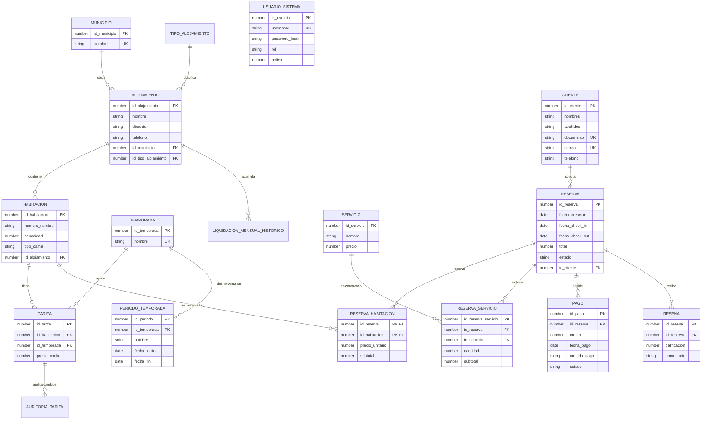

# Documento Técnico de Arquitectura, Modelo Relacional y Decisiones de Diseño

**Universidad del Quindío — Facultad de Ingeniería**  
**Programa:** Ingeniería de Sistemas y Computación  
**Asignatura:** Bases de Datos II (Código 12338) — Periodo 2026-2  
**Proyecto Integrador:** TurismoUQ — Plataforma de Reservas Turísticas del Quindío  
**Estudiantes:** Samuel Ortiz, Samuel Zuluaga Castaño  
**Motor:** Oracle Database 21c Express Edition (`XEPDB1`) — Esquema `TURISMO_UQ`  

---

## 1. Contexto del Negocio y Dominio del Problema

El departamento del Quindío sustenta su economía en el turismo cultural, de naturaleza y cafetero. Su comportamiento de demanda es marcadamente estacional: experimenta picos de saturación durante **Semana Santa**, la temporada de **vacaciones de mitad de año** (junio–julio), los **puentes festivos** y la temporada de **fin de año e inicio de año** (diciembre–enero), mientras que el resto de los meses opera bajo ocupación moderada.

**TurismoUQ** centraliza la oferta de hospedajes de los **12 municipios del departamento** (Armenia, Buenavista, Calarcá, Circasia, Córdoba, Filandia, Génova, La Tebaida, Montenegro, Pijao, Quimbaya y Salento), abarcando diversas tipologías: fincas tradicionales, haciendas cafeteras, eco-glampings y hoteles boutique. Asimismo, gestiona reservas concurrentes, liquidaciones mensuales por alojamiento, consumos de actividades turísticas complementarias y auditoría de tarifas.

---

## 2. Diagrama Entidad-Relación del Modelo (14 Entidades Mínimas)

El modelo satisface rigurosamente las 14 entidades obligatorias estipuladas en el encargo académico, sin eliminar ninguna:



---

## 3. Defensa de las Dos Decisiones Clave de Diseño

### Decisión de Diseño 1: ¿Cómo modelar que una reserva tome varias habitaciones?

#### El dilema arquitectónico
En modelos relacionales simplistas, se coloca la clave foránea `id_habitacion` directamente dentro de la tabla `RESERVA`. Esto introduce una restricción rígida de cardinalidad 1:1 (una reserva = exactamente una habitación), impidiendo que familias, grupos de amigos o eventos corporativos reserven dos o más habitaciones bajo un único titular, una única factura y una única transacción de pago.

#### Solución implementada en TurismoUQ
Se desacopló la reserva de la unidad habitacional a través de la entidad asociativa **`RESERVA_HABITACION`**:
- Clave primaria compuesta: `(id_reserva, id_habitacion)`.
- Atributos históricos propios:
  - `precio_unitario NUMBER(12,2)`: Tarifa congelada al momento de la confirmación.
  - `subtotal NUMBER(14,2)`: Importe total atribuible a esa habitación (`precio_promedio * noches`).
- Clave foránea con borrado en cascada controlado (`ON DELETE CASCADE`) respecto a `RESERVA`.

#### Ventajas técnicas y de negocio:
1. **Flexibilidad N:M:** Un cliente puede apartar 1, 2, 5 o más habitaciones de un mismo alojamiento en una sola reserva atómica.
2. **Inmutabilidad contable:** Si las tarifas cambian en el futuro en la tabla `TARIFA`, el subtotal pactado en `RESERVA_HABITACION` no se altera.
3. **Control de solapamiento granular:** El trigger anti-mutante `TRG_PREVENIR_SOLAPAMIENTO_RESHAB` opera a nivel de cada habitación individualmente, permitiendo verificar disponibilidad por habitación sin bloquear al resto de unidades de la reserva.

---

### Decisión de Diseño 2: ¿Cómo modelar que una estadía atraviese dos temporadas con tarifas distintas?

#### El dilema arquitectónico
Si una reserva inicia el **21 de marzo** (Temporada Baja) y culmina el **26 de marzo** (Semana Santa - Temporada Alta), una simple multiplicación de `tarifa * noches` o asociar la reserva a una sola temporada genera cobros injustos o pérdidas financieras para los propietarios hoteleros.

#### Solución implementada en TurismoUQ
Se diseñó un esquema desacoplado en 3 niveles:
1. **Tabla `TEMPORADA`:** Define únicamente dos temporadas universales:
   - `ID 1`: **Temporada Baja** (tarifa regular).
   - `ID 2`: **Temporada Alta** (tarifa con incremento exacto del **+40%** sobre la base).
2. **Tabla `PERIODO_TEMPORADA`:** Almacena los rangos de fechas de calendario (Semana Santa, Mitad de Año, Fin de Año) para los años 2024, 2025 y 2026.
3. **Cálculo algorítmico noche por noche en PL/SQL (`fn_valor_estadia`):**
   La función itera noche por noche desde `fecha_in` hasta `fecha_out - 1`. Para cada noche:
   ```sql
   SELECT COUNT(*) INTO v_es_alta
   FROM TURISMO_UQ.PERIODO_TEMPORADA
   WHERE id_temporada = 2
     AND v_fecha_actual BETWEEN TRUNC(fecha_inicio) AND TRUNC(fecha_fin);

   IF v_es_alta > 0 THEN
       v_total := v_total + v_tarifa_alta;
   ELSE
       v_total := v_total + v_tarifa_baja;
   END IF;
   ```

#### Ventajas técnicas y de negocio:
1. **Precisión al milésimo:** Cada noche se cobra con la tarifa que legalmente le corresponde según el calendario de alta demanda.
2. **Mantenibilidad sin invalidar datos históricos:** Si el próximo año cambian las fechas de Semana Santa, solo se agrega una fila en `PERIODO_TEMPORADA`, sin alterar las tarifas de las 400 habitaciones.
3. **Rendimiento optimizado:** La consulta se apoya en el índice B-Tree compuesto `idx_periodo_temp_fechas(id_temporada, fecha_inicio, fecha_fin)`, resolviendo el cálculo en menos de 3 milisegundos en Oracle XE.

---

## 4. Administración Física del Almacenamiento: Tablespace `TBS_HISTORICO_RESERVAS`

### Justificación Técnica DBA
En la base de datos coexisten tablas maestras de lectura frecuente y bajo crecimiento (`MUNICIPIO`, `ALOJAMIENTO`, `HABITACION`) junto a tablas transaccionales de alto volumen y constante mutación (`RESERVA`, `RESERVA_HABITACION`, `RESERVA_SERVICIO`, `PAGO`, `LIQUIDACION_MENSUAL_HISTORICO`).

La separación física en `TBS_HISTORICO_RESERVAS` garantiza:
1. **Aislamiento de I/O:** Las operaciones concurrentes de reservas y liquidaciones masivas no compiten por los bloques de disco del tablespace `USERS`.
2. **Estrategia RMAN Diferenciada:** Permite respaldos incrementales diarios sobre el tablespace histórico y semanales sobre catálogos.
3. **Mantenimiento sin indisponibilidad:** Reorganización de segmentos (`ALTER TABLE MOVE`) y reconstrucción de índices (`REBUILD`) sin afectar el catálogo maestro.
4. **Archivado histórico (`READ ONLY`):** Posibilidad de congelar particiones o años fiscales cerrados sin sobrecargar el backup de producción.

---

## 5. Integridad Transaccional y Disparadores Compuestos

### 5.1 Prevención de Tabla Mutante (`ORA-04091`) en `TRG_PREVENIR_SOLAPAMIENTO_RESHAB`
En Oracle, un trigger simple `FOR EACH ROW` sobre `RESERVA_HABITACION` que consulte `RESERVA_HABITACION` o `RESERVA` para detectar cruces de fechas genera el error de tabla mutante `ORA-04091`.

Se implementó un **Compound Trigger**:
- `BEFORE STATEMENT`: Limpia la colección temporal en PGA.
- `AFTER EACH ROW`: Captura los IDs (`id_reserva`, `id_habitacion`) en memoria sin realizar consultas a la tabla en mutación.
- `AFTER STATEMENT`: Una vez finalizada la sentencia DML y cuando la tabla ya no se encuentra en estado mutante, valida la condición analítica de cruce de fechas:
  `r.fecha_check_in < v_out_date AND r.fecha_check_out > v_in_date`. Si hay solapamiento, aborta la transacción con `RAISE_APPLICATION_ERROR(-20003, ...)`.

### 5.2 Auditoría Dual (Fila y Sentencia) en `TRG_AUDITORIA_TARIFA`
Para cumplir simultáneamente el requerimiento de disparador a nivel de sentencia y la captura de valores anterior/nuevo:
- `AFTER EACH ROW`: Inserta en `AUDITORIA_TARIFA` quién modificó, fecha, valor anterior (`:OLD.precio_noche`), valor nuevo (`:NEW.precio_noche`) y acción (`INSERT/UPDATE/DELETE`).
- `AFTER STATEMENT`: Inserta en `LOG_SENTENCIA_TARIFA` el resumen consolidado de la sentencia ejecutada (usuario, timestamp, acción y cantidad total de filas afectadas).

---

## 6. Verificación del Volumen Mínimo de Datos

| Entidad / Métrica | Requisito Mínimo (PDF) | Cantidad Generada en Script | Estado |
| :--- | :---: | :---: | :---: |
| **Municipios** | 12 | **12** | ✅ Cumplido |
| **Alojamientos** | 60 | **60** (5 por municipio) | ✅ Cumplido |
| **Habitaciones** | 400 | **400** (distribuidas en los 60 alojamientos) | ✅ Cumplido |
| **Clientes** | 3.000 | **3.000** (con documentos y correos únicos) | ✅ Cumplido |
| **Reservas** | 25.000 (2024-2026) | **25.000** repartidas en los 3 años | ✅ Cumplido |
| **Líneas de Servicios** | 40.000 | **40.000** consumos en `RESERVA_SERVICIO` | ✅ Cumplido |
| **Pagos** | — | **25.000** pagos atómicos asociados | ✅ Cumplido |
| **Tarifas** | — | **800** (400 baja + 400 alta con regla +40%) | ✅ Cumplido |
| **Usuarios Sistema (App)** | — | **5** (`admin_uq`, `recepcion_uq`, `admin_alojamiento_uq`, `gerente_uq`, `auditor_uq`) | ✅ Cumplido |
| **Usuarios BD Oracle** | — | **4** (`USR_RECEPCION`, `USR_ADMIN_ALOJ`, `USR_GERENTE`, `USR_AUDITOR`) con `PERFIL_TURISMO_OPERATIVO` | ✅ Cumplido |

---

### 6.1 Nuevas Consultas Analíticas Adicionales (`04_consultas_analisis.sql`)

Además de las 8 consultas obligatorias, se incorporaron en SQL, Backend REST (`/api/analitica/...`) y Frontend Angular:

1. **Consulta 9 — Habitación con más reservas en Temporada Alta:**
   - Cruza `RESERVA`, `RESERVA_HABITACION`, `HABITACION`, `ALOJAMIENTO`, `MUNICIPIO` y verifica mediante `EXISTS` sobre `PERIODO_TEMPORADA (id_temporada = 2)` excluyendo canceladas, aplicando `DENSE_RANK()` para identificar la líder.
   - Resultado verificado sobre los 25.035 registros del entorno local: **Habitación 105 (`ID #291`) — Alojamiento Turistico UQ 42 (Montenegro)** con **23 reservas** en temporada alta y **$18.562.000 COP**.
2. **Consulta 10 — Listado de clientes con más municipios visitados:**
   - Agrupa por cliente calculando `COUNT(DISTINCT m.id_municipio)`, `COUNT(DISTINCT r.id_reserva)`, `SUM(r.total)` y consolidando los nombres de municipios con `LISTAGG(DISTINCT m.nombre, ', ') WITHIN GROUP (ORDER BY m.nombre)`.
   - Resultado verificado en el entorno local: **Carlos Perez (`ID #1902`)** con **12 de 12 municipios del Quindío** visitados (17 reservas), seguido de clientes con 11 y 10 municipios.

---

## 7. Entrega 3: Transacciones, Concurrencia, Índices (CBO) y Seguridad

### 7.1 Transacción Atómica con `SAVEPOINT` y Rollback Parcial (`01_transacciones_savepoint.sql`)
El procedimiento `TURISMO_UQ.sp_reserva_transaccional_pago` registra la reserva y su pago en una misma unidad lógica de trabajo:
1. Inserta el encabezado en `RESERVA` (estado inicial `'PENDIENTE'`) y el detalle en `RESERVA_HABITACION`.
2. Establece el punto de salvaguarda: `SAVEPOINT sp_reserva_creada;`.
3. En un sub-bloque transaccional intenta registrar el pago en `PAGO`.
4. **Si el pago es exitoso:** actualiza la reserva a `'CONFIRMADA'` y ejecuta `COMMIT` total.
5. **Si el pago falla (`ORA-20007` o error de restricción):** captura la excepción, ejecuta `ROLLBACK TO SAVEPOINT sp_reserva_creada` (revirtiendo únicamente el pago) y ejecuta `COMMIT` para resguardar la reserva en estado `'PENDIENTE'` sin que el huésped pierda su disponibilidad.

### 7.2 Concurrencia y Bloqueo Pesimista de Fila (`02_concurrencia_bloqueos.sql`)
El procedimiento `TURISMO_UQ.sp_reservar_con_bloqueo` serializa el intento concurrente de dos sesiones sobre la misma habitación mediante:
```sql
SELECT capacidad, numero_nombre
INTO v_capacidad, v_numero_hab
FROM TURISMO_UQ.HABITACION
WHERE id_habitacion = p_id_habitacion
FOR UPDATE WAIT 5;
```

**Comparativa Antes vs Después:**

| Aspecto | Sin `SELECT ... FOR UPDATE` (Antes) | Con `SELECT ... FOR UPDATE` (Después) |
| :--- | :--- | :--- |
| **Lectura bajo `READ COMMITTED`** | Ambas sesiones leen `0` solapamientos antes del primer `COMMIT` (*Race Condition*). | Sesión 1 toma candado exclusivo de fila (`Row-X TX Lock`) sobre `HABITACION`. |
| **Comportamiento Sesión 2** | Avanza paralelamente e intenta insertar la misma habitación en las mismas fechas. | Espera en cola (`enq: TX - row lock contention`) hasta que Sesión 1 haga `COMMIT`/`ROLLBACK`. |
| **Resolución de contención** | Conflicto tardío en inserción / inconsistencia de cupo. | Si Sesión 1 no libera a tiempo: `ORA-20008`; si libera tras confirmar: `ORA-20003` (rechazo limpio). |

**Comandos reproducibles del experimento en dos sesiones (SQL*Plus / SQL Developer) y monitoreo en `V$LOCK`:**
```sql
-- SESIÓN 1 (Terminal A): Adquiere bloqueo exclusivo de fila sin confirmar aún
ALTER SESSION SET CONTAINER = XEPDB1;
SELECT id_habitacion, numero_nombre, capacidad
FROM TURISMO_UQ.HABITACION WHERE id_habitacion = 1 FOR UPDATE;

-- SESIÓN 2 (Terminal B, en paralelo): Queda bloqueada esperando en row lock contention
ALTER SESSION SET CONTAINER = XEPDB1;
DECLARE v_id NUMBER; v_tot NUMBER; v_msg VARCHAR2(500);
BEGIN
    TURISMO_UQ.sp_reservar_con_bloqueo(2, 1, DATE '2027-09-10', DATE '2027-09-14', 2, 5, v_id, v_tot, v_msg);
END;
/

-- MONITOREO DBA (Sesión C): Visualizar bloqueador, bloqueado y evento de espera
SELECT s1.sid AS sid_bloqueador, s1.username, s2.sid AS sid_esperando,
       s2.event AS evento_espera, s2.seconds_in_wait
FROM v$lock l1
JOIN v$session s1 ON l1.sid = s1.sid
JOIN v$lock l2    ON l1.id1 = l2.id1 AND l1.id2 = l2.id2
JOIN v$session s2 ON l2.sid = s2.sid
WHERE l1.block = 1 AND l2.request > 0;
```

### 7.3 Optimización con Índices y Caso Negativo del CBO (`03_indices_optimizacion.sql`)
Se evaluaron los planes de ejecución (`EXPLAIN PLAN` + `DBMS_XPLAN.DISPLAY`) sobre las **25.035 reservas** y **40.000 servicios** y se incorporó medición dinámica de tiempos de ejecución con `DBMS_SQL` + `SYSTIMESTAMP`:

| Caso | Índice Evaluado | Tipo | Operación Antes (Costo CBO) | Operación Después (Costo CBO) | Impacto CBO |
| :--- | :--- | :--- | :---: | :---: | :---: |
| **Q1** | `IDX_COMP_RESERVA_EST_CREA` | Compuesto B-Tree `(estado, fecha_creacion, total)` | `TABLE ACCESS (FULL)` (**73**) | `INDEX (RANGE SCAN DESCENDING)` (**2**) | **-97.26%** |
| **Q2** | `IDX_FBI_RESERVA_ANIO_MES` | Basado en Función `(TO_CHAR(fecha_check_in,'YYYY-MM-DD'), UPPER(TRIM(estado)))` | `TABLE ACCESS (FULL)` (**72**) | `INDEX (RANGE SCAN)` (**23**) | **-68.06%** |
| **Q3** | `IDX_COMP_RESSERV_SERV_CANT` | Compuesto Cobertura `(id_servicio, cantidad, subtotal)` | `TABLE ACCESS (FULL)` (**42**) | `INDEX (RANGE SCAN)` (**2**) | **-95.24%** |
| **Q4 (Caso Negativo)** | `IDX_COMP_RESERVA_EST_CREA` | Filtro baja selectividad `estado IN ('CONFIRMADA','FINALIZADA','PENDIENTE')` | `TABLE ACCESS (FULL)` Natural (**72**) | `INDEX (RANGE SCAN)` + `ROWID BATCHED` Forzado (**24.986**) | **+34.602% (347x peor)** |

**¿Por qué el índice NO ayuda en el Caso 4?**
1. **Baja Selectividad:** El predicado filtra casi el 100% de las filas de `RESERVA`.
2. **Lecturas Single-Block vs Multi-Block:** Al forzar el índice con `/*+ INDEX(r IDX_COMP_RESERVA_EST_CREA) */`, Oracle debe recorrer las hojas del índice y realizar ~25.000 saltos aleatorios por `ROWID` hacia los bloques de la tabla (`TABLE ACCESS BY INDEX ROWID BATCHED`) para recuperar columnas no cubiertas (`id_cliente`, `fecha_check_in`, `fecha_check_out`).
3. **Clustering Factor:** Un mismo bloque físico de la tabla es leído repetidas veces en lecturas unitarias (`db file sequential read`), mientras que un `TABLE ACCESS FULL` lee bloques contiguos en ráfagas (`db_file_multiblock_read_count`), costando **72** frente a **24.986**.

### 7.4 Seguridad: 4 Roles, Aislamiento por Vistas, Perfil y Usuarios Oracle (`04_seguridad_roles_perfiles.sql`)
- **4 Roles Diferenciados:**
  1. `ROL_RECEPCION`: **0 permisos sobre tablas directas**. Opera exclusivamente sobre las vistas `VW_RECEPCION_RESERVAS` (con `Trigger INSTEAD OF UPDATE`), `VW_RECEPCION_CHECKIN` y `VW_RECEPCION_HABITACIONES_DISP` (+ `CREATE SESSION`).
  2. `ROL_ADMIN_ALOJAMIENTO`: Permisos `SELECT, INSERT, UPDATE` sobre `ALOJAMIENTO`, `HABITACION`, `TARIFA`, `SERVICIO`, lectura de temporadas y ejecución de `PKG_TURISMO_RESERVAS`.
  3. `ROL_GERENTE`: Lectura sobre `MV_OCUPACION_MENSUAL`, `LIQUIDACION_MENSUAL_HISTORICO` y tablas de facturación.
  4. `ROL_AUDITOR`: Lectura inmutable sobre `AUDITORIA_TARIFA`, `LOG_SENTENCIA_TARIFA`, `AUDITORIA_PLANES_INDICES`, `TARIFA` y `USUARIO_SISTEMA`.
- **4 Usuarios reales en Oracle XE (`XEPDB1`) con `PERFIL_TURISMO_OPERATIVO` (`RESOURCE_LIMIT = TRUE`):**
  - `USR_RECEPCION` (`ROL_RECEPCION`) · `USR_ADMIN_ALOJ` (`ROL_ADMIN_ALOJAMIENTO`) · `USR_GERENTE` (`ROL_GERENTE`) · `USR_AUDITOR` (`ROL_AUDITOR`).
- **Perfil de Recursos (`PERFIL_TURISMO_OPERATIVO`):**
  - `SESSIONS_PER_USER 2`, `IDLE_TIME 30`, `CONNECT_TIME 480`, `FAILED_LOGIN_ATTEMPTS 3`, `PASSWORD_LIFE_TIME 90`, `PASSWORD_LOCK_TIME 1`, `PASSWORD_GRACE_TIME 7`.
- **Verificación de aislamiento de recepción en SQL*Plus (conectando como `USR_RECEPCION`):**
  - `SELECT * FROM TURISMO_UQ.VW_RECEPCION_RESERVAS FETCH FIRST 5 ROWS ONLY;` → **Permitido**.
  - `SELECT * FROM TURISMO_UQ.RESERVA FETCH FIRST 5 ROWS ONLY;` → **Denegado (`ORA-00942`)**.

---

## 8. Instrucciones de Despliegue en Base Limpia

Para instalar y validar el proyecto completo (Entregas 1, 2 y 3) en una instancia limpia de Oracle Database 21c XE (`XEPDB1`):

```powershell
# 1. Conectarse como administrador DBA (necesario para crear esquema, tablespace, roles, perfil y usuarios)
sqlplus / as sysdba

# 2. Ejecutar el script maestro único de arriba a abajo (Pasos 0 al 14):
@database/00_master_instalacion_completa.sql
```

El script creará/verificará de forma idempotente el usuario `TURISMO_UQ` (`00_prerequisitos_dba_esquema.sql`), ejecutará del paso 1 al 14, correrá las baterías de pruebas automatizadas de Entrega 2 y Entrega 3, verificará que existan **0 objetos inválidos** y emitirá el reporte de conteo final.
