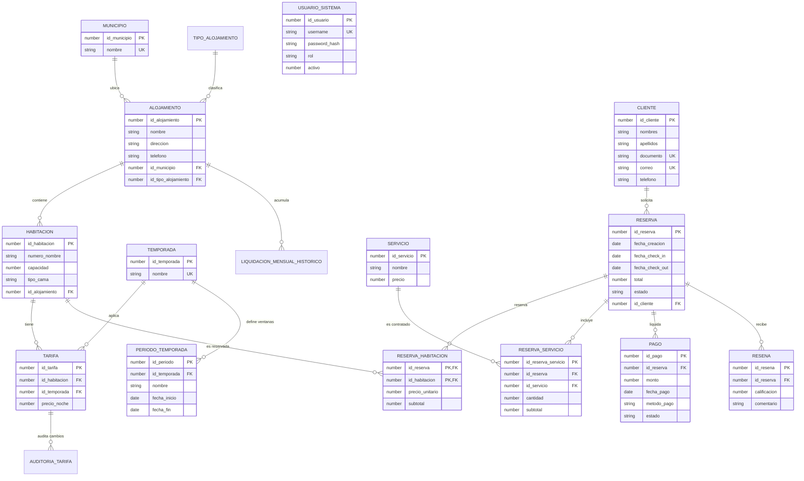

# Documento Técnico de Arquitectura, Modelo Relacional y Decisiones de Diseño

**Universidad del Quindío — Facultad de Ingeniería**  
**Programa:** Ingeniería de Sistemas y Computación  
**Asignatura:** Bases de Datos II (Código 12338) — Periodo 2026-2  
**Proyecto Integrador:** TurismoUQ — Plataforma de Reservas Turísticas del Quindío  
**Estudiante:** Samuel Ortiz  
**Motor:** Oracle Database 21c Express Edition (`XEPDB1`) — Esquema `TURISMO_UQ`  

---

## 1. Contexto del Negocio y Dominio del Problema

El departamento del Quindío sustenta su economía en el turismo cultural, de naturaleza y cafetero. Su comportamiento de demanda es marcadamente estacional: experimenta picos de saturación durante **Semana Santa**, la temporada de **vacaciones de mitad de año** (junio–julio), los **puentes festivos** y la temporada de **fin de año e inicio de año** (diciembre–enero), mientras que el resto de los meses opera bajo ocupación moderada.

**TurismoUQ** centraliza la oferta de hospedajes de los **12 municipios del departamento** (Armenia, Buenavista, Calarcá, Circasia, Córdoba, Filandia, Génova, La Tebaida, Montenegro, Pijao, Quimbaya y Salento), abarcando diversas tipologías: fincas tradicionales, haciendas cafeteras, eco-glampings y hoteles boutique. Asimismo, gestiona reservas concurrentes, liquidaciones mensuales por alojamiento, consumos de actividades turísticas complementarias y auditoría de tarifas.

---

## 2. Diagrama Entidad-Relación del Modelo (14 Entidades Mínimas)

El modelo satisface rigurosamente las 14 entidades obligatorias estipuladas en el encargo académico, sin eliminar ninguna:



---

## 3. Defensa de las Dos Decisiones Clave de Diseño

### Decisión de Diseño 1: ¿Cómo modelar que una reserva tome varias habitaciones?

#### El dilema arquitectónico
En modelos relacionales simplistas, se coloca la clave foránea `id_habitacion` directamente dentro de la tabla `RESERVA`. Esto introduce una restricción rígida de cardinalidad 1:1 (una reserva = exactamente una habitación), impidiendo que familias, grupos de amigos o eventos corporativos reserven dos o más habitaciones bajo un único titular, una única factura y una única transacción de pago.

#### Solución implementada en TurismoUQ
Se desacopló la reserva de la unidad habitacional a través de la entidad asociativa **`RESERVA_HABITACION`**:
- Clave primaria compuesta: `(id_reserva, id_habitacion)`.
- Atributos históricos propios:
  - `precio_unitario NUMBER(12,2)`: Tarifa congelada al momento de la confirmación.
  - `subtotal NUMBER(14,2)`: Importe total atribuible a esa habitación (`precio_promedio * noches`).
- Clave foránea con borrado en cascada controlado (`ON DELETE CASCADE`) respecto a `RESERVA`.

#### Ventajas técnicas y de negocio:
1. **Flexibilidad N:M:** Un cliente puede apartar 1, 2, 5 o más habitaciones de un mismo alojamiento en una sola reserva atómica.
2. **Inmutabilidad contable:** Si las tarifas cambian en el futuro en la tabla `TARIFA`, el subtotal pactado en `RESERVA_HABITACION` no se altera.
3. **Control de solapamiento granular:** El trigger anti-mutante `TRG_PREVENIR_SOLAPAMIENTO_RESHAB` opera a nivel de cada habitación individualmente, permitiendo verificar disponibilidad por habitación sin bloquear al resto de unidades de la reserva.

---

### Decisión de Diseño 2: ¿Cómo modelar que una estadía atraviese dos temporadas con tarifas distintas?

#### El dilema arquitectónico
Si una reserva inicia el **21 de marzo** (Temporada Baja) y culmina el **26 de marzo** (Semana Santa - Temporada Alta), una simple multiplicación de `tarifa * noches` o asociar la reserva a una sola temporada genera cobros injustos o pérdidas financieras para los propietarios hoteleros.

#### Solución implementada en TurismoUQ
Se diseñó un esquema desacoplado en 3 niveles:
1. **Tabla `TEMPORADA`:** Define únicamente dos temporadas universales:
   - `ID 1`: **Temporada Baja** (tarifa regular).
   - `ID 2`: **Temporada Alta** (tarifa con incremento exacto del **+40%** sobre la base).
2. **Tabla `PERIODO_TEMPORADA`:** Almacena los rangos de fechas de calendario (Semana Santa, Mitad de Año, Fin de Año) para los años 2024, 2025 y 2026.
3. **Cálculo algorítmico noche por noche en PL/SQL (`fn_valor_estadia`):**
   La función itera noche por noche desde `fecha_in` hasta `fecha_out - 1`. Para cada noche:
   ```sql
   SELECT COUNT(*) INTO v_es_alta
   FROM TURISMO_UQ.PERIODO_TEMPORADA
   WHERE id_temporada = 2
     AND v_fecha_actual BETWEEN TRUNC(fecha_inicio) AND TRUNC(fecha_fin);

   IF v_es_alta > 0 THEN
       v_total := v_total + v_tarifa_alta;
   ELSE
       v_total := v_total + v_tarifa_baja;
   END IF;
   ```

#### Ventajas técnicas y de negocio:
1. **Precisión al milésimo:** Cada noche se cobra con la tarifa que legalmente le corresponde según el calendario de alta demanda.
2. **Mantenibilidad sin invalidar datos históricos:** Si el próximo año cambian las fechas de Semana Santa, solo se agrega una fila en `PERIODO_TEMPORADA`, sin alterar las tarifas de las 400 habitaciones.
3. **Rendimiento optimizado:** La consulta se apoya en el índice B-Tree compuesto `idx_periodo_temp_fechas(id_temporada, fecha_inicio, fecha_fin)`, resolviendo el cálculo en menos de 3 milisegundos en Oracle XE.

---

## 4. Administración Física del Almacenamiento: Tablespace `TBS_HISTORICO_RESERVAS`

### Justificación Técnica DBA
En la base de datos coexisten tablas maestras de lectura frecuente y bajo crecimiento (`MUNICIPIO`, `ALOJAMIENTO`, `HABITACION`) junto a tablas transaccionales de alto volumen y constante mutación (`RESERVA`, `RESERVA_HABITACION`, `RESERVA_SERVICIO`, `PAGO`, `LIQUIDACION_MENSUAL_HISTORICO`).

La separación física en `TBS_HISTORICO_RESERVAS` garantiza:
1. **Aislamiento de I/O:** Las operaciones concurrentes de reservas y liquidaciones masivas no compiten por los bloques de disco del tablespace `USERS`.
2. **Estrategia RMAN Diferenciada:** Permite respaldos incrementales diarios sobre el tablespace histórico y semanales sobre catálogos.
3. **Mantenimiento sin indisponibilidad:** Reorganización de segmentos (`ALTER TABLE MOVE`) y reconstrucción de índices (`REBUILD`) sin afectar el catálogo maestro.
4. **Archivado histórico (`READ ONLY`):** Posibilidad de congelar particiones o años fiscales cerrados sin sobrecargar el backup de producción.

---

## 5. Integridad Transaccional y Disparadores Compuestos

### 5.1 Prevención de Tabla Mutante (`ORA-04091`) en `TRG_PREVENIR_SOLAPAMIENTO_RESHAB`
En Oracle, un trigger simple `FOR EACH ROW` sobre `RESERVA_HABITACION` que consulte `RESERVA_HABITACION` o `RESERVA` para detectar cruces de fechas genera el error de tabla mutante `ORA-04091`.

Se implementó un **Compound Trigger**:
- `BEFORE STATEMENT`: Limpia la colección temporal en PGA.
- `AFTER EACH ROW`: Captura los IDs (`id_reserva`, `id_habitacion`) en memoria sin realizar consultas a la tabla en mutación.
- `AFTER STATEMENT`: Una vez finalizada la sentencia DML y cuando la tabla ya no se encuentra en estado mutante, valida la condición analítica de cruce de fechas:
  `r.fecha_check_in < v_out_date AND r.fecha_check_out > v_in_date`. Si hay solapamiento, aborta la transacción con `RAISE_APPLICATION_ERROR(-20003, ...)`.

### 5.2 Auditoría Dual (Fila y Sentencia) en `TRG_AUDITORIA_TARIFA`
Para cumplir simultáneamente el requerimiento de disparador a nivel de sentencia y la captura de valores anterior/nuevo:
- `AFTER EACH ROW`: Inserta en `AUDITORIA_TARIFA` quién modificó, fecha, valor anterior (`:OLD.precio_noche`), valor nuevo (`:NEW.precio_noche`) y acción (`INSERT/UPDATE/DELETE`).
- `AFTER STATEMENT`: Inserta en `LOG_SENTENCIA_TARIFA` el resumen consolidado de la sentencia ejecutada (usuario, timestamp, acción y cantidad total de filas afectadas).

---

## 6. Verificación del Volumen Mínimo de Datos

| Entidad / Métrica | Requisito Mínimo (PDF) | Cantidad Generada en Script | Estado |
| :--- | :---: | :---: | :---: |
| **Municipios** | 12 | **12** | ✅ Cumplido |
| **Alojamientos** | 60 | **60** (5 por municipio) | ✅ Cumplido |
| **Habitaciones** | 400 | **400** (distribuidas en los 60 alojamientos) | ✅ Cumplido |
| **Clientes** | 3.000 | **3.000** (con documentos y correos únicos) | ✅ Cumplido |
| **Reservas** | 25.000 (2024-2026) | **25.000** repartidas en los 3 años | ✅ Cumplido |
| **Líneas de Servicios** | 40.000 | **40.000** consumos en `RESERVA_SERVICIO` | ✅ Cumplido |
| **Pagos** | — | **25.000** pagos atómicos asociados | ✅ Cumplido |
| **Tarifas** | — | **800** (400 baja + 400 alta con regla +40%) | ✅ Cumplido |
| **Usuarios Sistema** | — | **4** (recepción, admin, gerente, auditor) | ✅ Cumplido |

---

## 7. Instrucciones de Despliegue en Base Limpia

Para calificar el proyecto en una instalación limpia de Oracle Database 21c XE:

```powershell
# 1. Conectarse a la PDB XEPDB1 en SQL*Plus o SQL Developer
sqlplus TURISMO_UQ/TurismoUQ2026#@localhost:1521/XEPDB1

# 2. Ejecutar el script maestro único:
@database/00_master_instalacion_completa.sql
```

El script ejecutará secuencialmente del paso 1 al 9, imprimirá el progreso en consola, verificará que existan **0 objetos inválidos** y emitirá el reporte de conteo con el volumen mínimo verificado al 100%.
